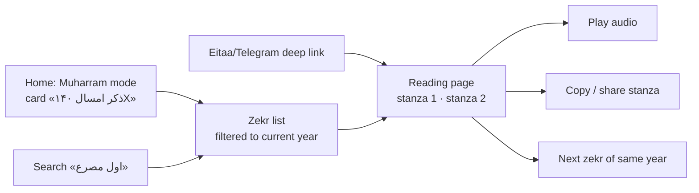
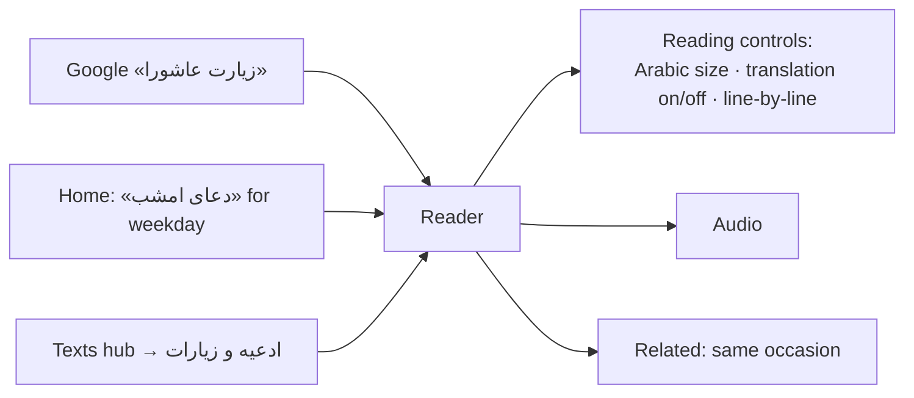
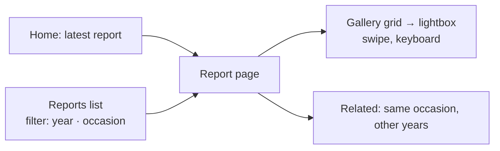
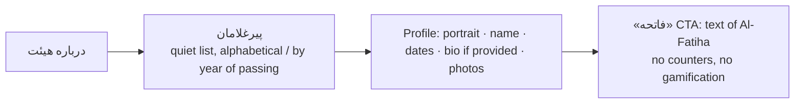
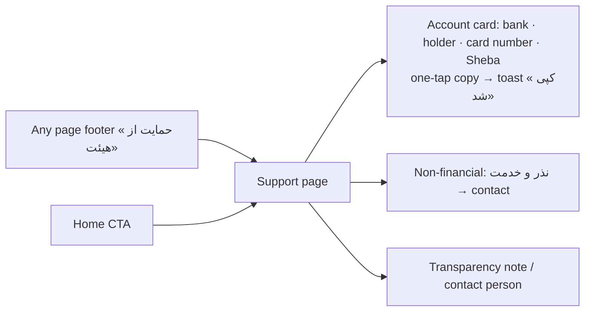
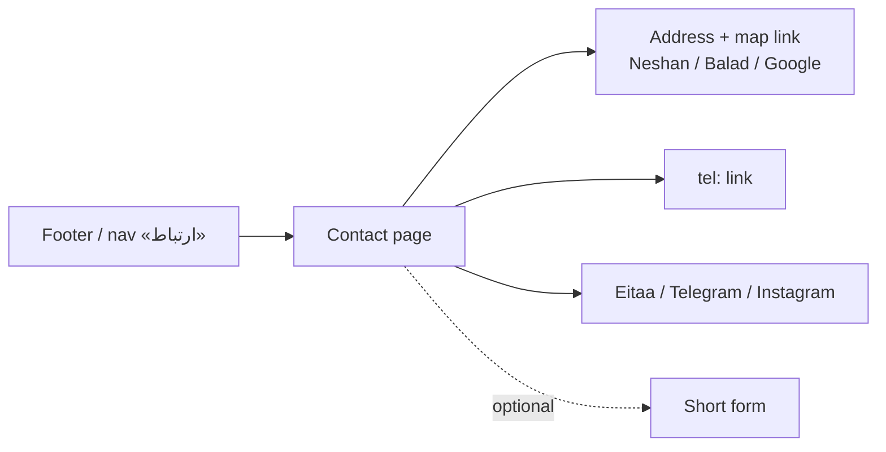
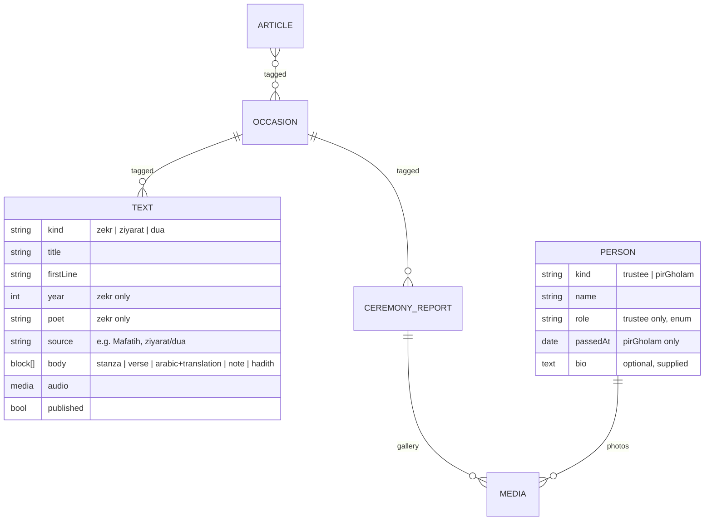
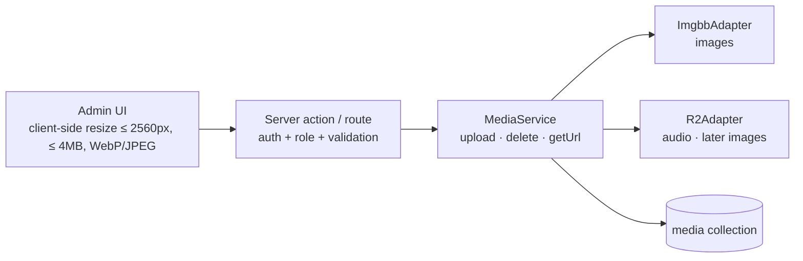
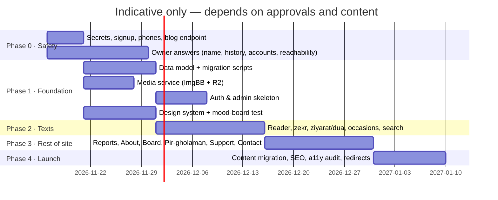

# Abasieh — Product & Design Case Study

| | |
|---|---|
| **Status** | Proposal. Not approved for implementation |
| **Date** | 2026-11-11 |
| **Inputs** | `docs/context/*` (code audit), a runtime check of the running dev server, and web research (§32) |
| **Owner decisions needed** | See §31. Nothing in this document is a confirmed requirement unless it's labeled **[Verified]** |

**Evidence labels used throughout**

| Label | Meaning |
|---|---|
| **[Verified]** | Confirmed in code, at runtime, or in a cited source |
| **[Source]** | Taken from an external source and not confirmed by the Heyat. Needs owner confirmation |
| **[Proposal]** | A recommendation from this study |
| **[Open]** | A question for the product owner |

---

## 1. Executive Summary

Abasieh is the website of **هیئت سقایی عباسیه جولان**, a Saqaei mourning association in the historic Joulan neighbourhood of Hamedan. Secondary sources describe it as the city's first and best-known Saqaei Heyat [Source, §4.4].

**What the site has today** [Verified]:
- An archive of the Heyat's annual Saqaei *zekr* (chant) texts with audio.
- A small library of *ziyarat-nameh*.
- A photo gallery of past ceremonies.
- Pages for the board of trustees and the deceased honored elders (*pir-gholaman*).
- Contact and donation pages.
- An admin panel to manage all of the above.

**The most important findings**

1. **The site doesn't run in its current state** [Verified]. On the running Next 16 dev server, every route returns HTTP 500. The cause is a compile error from the uncommitted dependency upgrade: `jalaali-js` v2 removed its default export. Underneath that sits a backlog of security defects, including:
   - public admin sign-up
   - secrets committed to git
   - trustees' phone numbers published
   - no role checks in the API

   It also has broken edit and delete flows, and a home page that is a placeholder.

2. **The product's real asset is the Saqaei zekr archive.** This is content no one else on the web holds: the chants the Heyat performs each Muharram, organized by year, with poet and audio. Everything else is supporting context. The current site buries this archive behind a hamburger menu and generic cards.

3. **The new product should be a calm, reading-first cultural archive with a strong seasonal pulse**, not a news portal and not a generic religious template. Most of the year it serves people who look things up: a ziyarat, a chant, a photo, the account number. During Muharram (especially nights 4–14, the Heyat's Saqaei procession nights [Source]) it should put that season's program and texts first.

**Recommendations at a glance**

| Area | Recommendation |
|---|---|
| Product | Five pillars: **Texts** (zekr + ziyarat/dua), **Ceremonies**, **The Heyat** (history, trustees, pir-gholaman), **Support**, **Contact**. Articles are deferred until there's an editor to write them |
| Navigation | A visible desktop top bar with 6 items and search. A mobile bottom bar with 4 destinations plus a menu. Texts are reached by **occasion** as well as by type |
| Visual | Direction **A, «سقاخانه» (water, lamp and brick)**: a light, warm-stone reading surface; a deep-ink type system; water-teal and brass as restrained accents; a seasonal *Muharram* mode |
| Typography | **Vazirmatn** (OFL) for UI and Persian text, a Naskh face for Arabic liturgical text, and Peyda kept for display only if its web license allows |
| Storage | A provider-agnostic `MediaService`. **Images go to ImgBB now (owner direction). Audio can't go to ImgBB** (image-only), so it needs object storage (Cloudflare R2 is recommended) or the audio feature waits |
| First priorities | Rotate secrets, close admin sign-up, and hide phone numbers. Then rebuild the data model and media layer, then the Texts experience |

---

## 2. Project Background

| Item | Finding |
|---|---|
| Organization | **هیئت سقایی عباسیه جولان**, Hamedan [Verified in code, the navbar and all metadata; corroborated by ISNA Hamedan, the Hegmataneh newspaper and sufism.ir, §32] |
| Name in the brief | «هیئت سقای اباعباسی چورلان همدان». **No source found uses "چورلان".** The social handles (`abbasie_julan`) and the contact email also use *Julan/Joulan*. [Open Q-1] |
| Location | Shohada St → Ayatollah Taleghani Blvd (Joulan), opposite the Askariyeh Mosque, at the end of Abbasiyeh 2 Alley [Source: sufism.ir]. The code's address text is consistent with this |
| History | Founded around **1277 SH** (≈1898), according to elder members' testimony. The founder was the late Sayyed Ahmad Ruhbakhsh, with Karbalai Abolqasem Saqqa [Source: an Anhar e-library text]. Another source says the founding date is unknown. **This must be confirmed by the Heyat before publication** [Open Q-2] |
| Annual program | Quran recitation and interpretation on nights 1–3 of Muharram, then mourning and the Saqaei procession on nights 4–14 [Source: Hegmataneh listing]. Saqqas wear long black robes and carry a *kashkul* [Source: hamedannegar] |
| Codebase | A solo-developer Next.js project from July to September 2024, with an abandoned blog started in March 2025 and an uncommitted dependency upgrade in November 2026. See `docs/context/PROGRESS.md` |

---

## 3. Product Vision

> **Abasieh is the digital home and memory of the Saqaei Heyat of Joulan.**
> It keeps the Heyat's texts readable and its history remembered. It shows the community what happened and what's coming, and it makes supporting the Heyat simple and trustworthy.

### Product principles

1. **Reading before browsing.** Most visits end on a text. Optimize the reader first.
2. **The Heyat's own voice first.** The Saqaei zekr archive and the Heyat's history are unique, so they get prominence. Generic religious content is supplementary.
3. **Seasonal, not static.** Muharram and Safar change what visitors need. The site should change emphasis with them.
4. **Dignity over decoration.** Restraint in imagery, color and motion. Memorials are quiet, and nothing is promotional.
5. **Truth over completeness.** Never invent history, biographies or financial data. An empty, honest section is better than a filled, fabricated one.
6. **Maintainable by volunteers.** Every feature must be manageable by non-technical admins in a few minutes. If it can't be maintained, it isn't built.

### Non-goals

These are out of scope unless the product owner decides otherwise:

- A news portal
- A social network or comments
- User accounts for visitors
- An online payment gateway
- Live streaming infrastructure
- A multi-language UI (Persian only; Arabic appears only as liturgical text)

---

## 4. Cultural and Historical Research

> Scope: this section gives the context designers need. It isn't theology. Established, sourced facts are separated from contemporary interpretation.

### 4.1 The Iranian Heyat

| Topic | Established | Interpretation / design relevance |
|---|---|---|
| What it is | A local association that holds mourning ceremonies for Imam Husayn and the Ahl al-Bayt. Gatherings usually combine Quran recitation, a sermon and mourning (*rawza*, *nawha*) [WikiShia, §32] | The site represents a *community*, not an institution. Its tone should be familial and local |
| The term | Mourning gatherings are ancient, but the word *hay'at* for them is about a century old [WikiShia] | The Heyat's own ~125-year history (if confirmed) is a real differentiator |
| Organization | Processions (*dasta*) were historically organized by neighbourhoods or guilds, with prescribed order and precedence [Iranica, "Dasta"] | Neighbourhood identity (Joulan) matters. Hierarchy (chair, members, elders) is culturally meaningful, so present it respectfully, not as "team cards" |
| Social role | Community participation, *nazri* (votive food), volunteer service. Heyats also had civic and political roles in modern Iran [Iranica; Kaynamazoğlu 2022] | Support isn't only money. Service and *nazr* are forms of participation. Keep the site **non-political** |

### 4.2 The Saqaei tradition (سقایی)

| Topic | Established | Interpretation / design relevance |
|---|---|---|
| Hazrat Abbas as *Saqqa* | ʿAbbās b. ʿAlī's epithet *al-Saqqā* ("the water-carrier") appears in early sources. He's honored in taʿziya and Muharram rituals as water-carrier and standard-bearer [Iranica, "ʿAbbās b. ʿAlī"]. He was killed on Ashura trying to bring water from the Euphrates to Husayn's camp [WikiShia] | **Water, the waterskin (*mashk*) and the standard (*ʿalam*)** are the core symbols. Thirst and giving water mean devotion and sacrifice |
| Saqqakhaneh | Began as charitable public drinking fountains that took on a devotional character. They're usually dedicated to Abbas, often built near a *takya*, with candles lit on Thursday nights and votive petitions left [Wikipedia "Saqakhaneh"; Iranica] | A strong, *specifically Iranian* visual source: tilework, the brass bowl, candlelight and small votive locks. It's more distinctive than generic geometric patterns |
| Votive water-carrying | Families dedicate young sons to carrying water for Muharram mourners, often fulfilling a vow made for a child's recovery [Iranica] | An authentic human story the "about" content could tell (only with the Heyat's own accounts) |
| In Hamedan | The custom is described as starting in Joulan. Saqqas wear long black robes and carry a *kashkul* [Source: hamedannegar] | The Heyat's ritual dress and objects are photographic subjects for the identity |
| Saqqakhaneh art movement | A 1960s Iranian modernist movement drew on this folk-devotional imagery (talismans, *ʿalam*, script) | Precedent for **contemporary design rooted in Saqaei imagery**, which validates Direction A (§17) |

**Terminology to use consistently in content** [Proposal]: سقا، سقایی، ذکر سقایی، مشک، علم، کشکول، پیرغلام، هیئت امنا، شب‌های محرم، تاسوعا، عاشورا. Use them in content and labels. Code identifiers can stay in English.

### 4.3 Religious content: types and how people look for them

| Type | Nature | How visitors look for it | Implication |
|---|---|---|---|
| **ذکر سقایی** (the Heyat's chants) | Authored poetry (poet, year), performed by the Heyat. Two stanzas (*band*) of hemistichs, each with an intro and a hadith [Verified, model]. *Unique to the Heyat* | By **year** ("this year's zekr"), by **night of Muharram**, by poet, by first line | Year and occasion are the primary axes. The first line is the "title" people remember |
| **زیارت‌نامه** | Canonical liturgical texts (for example Ziyarat Ashura), traditionally read from *Mafatih al-Jinan*. Arabic with Persian translation | By **name**, by **day** (Ashura, Arbaeen, Thursday nights), by the Imam addressed | Well known and searched by name. Readers need large, correctly vowelled Arabic and a line-aligned translation |
| **دعا** (Tawassul, Kumayl, etc.) | Same as above. Often tied to a weekday (Kumayl on Thursday night, Tawassul on Tuesday night) | By name and weekday | Same reader as ziyarat. "Tonight's dua" is a natural entry point |
| **Articles / history** | Narrative prose | Through search engines, links from other content, and sharing | Low volume, high effort. Valuable only with real authors |
| **Ceremony reports** | Dated photo records of past gatherings | By year, by occasion, "was I in this photo?" | Gallery-first, organized by date and occasion |

Benchmarks for reading UX, read on 2026-11-11 [§32]:

- **Quran.com** offers separate reading views (Arabic only, translation, word by word), audio from the page header, and per-verse depth (tafsir, reflections). Its help documents separate font-size controls for Arabic and translation, plus light, dark and sepia themes.
- **erfan.ir** puts *Mafatih al-Jinan* as a top-level nav item next to Quran, Nahj al-Balagha and Sahifa, and offers audio prayers.

People expect a named, top-level entry for prayers and ziyarat.

### 4.4 Visual and artistic research

| Source | What to take | What to avoid |
|---|---|---|
| **Saqqakhaneh** (tile niche, brass bowl, candle, *qofl* votive locks) | Limestone, brick and turquoise-tile palette; the arched niche as a framing device for featured content; candlelight as warm accent | Kitsch: clip-art candles, glowing effects |
| **ʿAlam and *katibeh* (black mourning banners with white or gold Naskh/Thuluth script)** | Strong typographic hierarchy; a banner band for seasonal announcements; text as image | Turning the whole site into a black banner. Unreadable decorative script for body text |
| **Kufi banna'i (square Kufic in brickwork)** | A *grid* logic for the layout and a possible monogram for «عباسیه» | Using it as wallpaper pattern |
| **Persian Naskh and Nastaliq** | Nastaliq only for the wordmark and display moments (a commissioned or properly licensed lettering, not a font gimmick). Naskh for Arabic text | Nastaliq for UI or body copy (poor legibility on screens) |
| **Islamic geometric girih** | At most a single, subtle structural motif (dividers, 404 page) | Dense background patterns; the generic "Islamic website" look |
| **Documentary ceremony photography** | Real, unposed, grainy-OK photographs of the Heyat's people and objects as the primary imagery | Stock photos, AI imagery, dramatic red overlays |

**Conclusion:** authenticity comes from **specific, local and photographic material** (the Heyat's own robes, *ʿalam*, alley and people) plus a disciplined type system, **not** from generic Islamic ornament.

---

## 5. Existing Product Analysis

*Full detail is in `docs/context/FEATURES.md`, `ARCHITECTURE.md` and `UI-UX.md`. Summary:*

| Dimension | Current state | Assessment |
|---|---|---|
| Identity | Text-only navbar title. No logo, imagery or story. The footer "about" is Lorem ipsum | **Absent.** The site doesn't say who the Heyat is |
| Home | The literal string `homem page` | **Absent** |
| Navigation | A hamburger on every breakpoint; 10 flat items; "Articles" and "Eitaa" link to `/`; a dead search icon | **Weak.** No hierarchy or desktop nav, and there are broken links |
| Content model | Good instincts: zekr by year with two stanzas, ziyarat as sections of Original, Translation and Note | **Keep the model idea**, fix the implementation |
| Reading UX | Arabic is set in the Persian UI font at body size. Stanza tabs are clickable `<p>` elements | **Poor** for the core use case |
| Ceremonies | A past-event gallery with no occasion, location or upcoming events | **Partial** |
| People | Trustee cards **publish full phone numbers**. Pir-gholaman cards are fine but sit at an inappropriate URL (`/oldSlaves`) | **Needs care** |
| Donate | Text with **empty** account labels | **Non-functional** |
| Admin | Covers all content types, but with duplicated forms, no dashboard and no sign-out | **Functional but fragile** |
| Engineering | No validation, no tests, media on local disk, broken authorization | **Rebuild** (see §28) |

---

## 6. Existing Feature Inventory

| # | Feature | Status today | Purpose | Useful? | Complexity vs. value | Belongs in the new product? |
|---|---|---|---|---|---|---|
| F-01 | Site shell (nav, footer, theme) | Partial | Wayfinding | Yes | Low / High | Yes. Rebuild |
| F-02 | Home | Placeholder | Orientation | Critical | — | Yes. Create |
| F-03 | Zekr archive | Works (HEAD) | Core heritage content | **Highest** | Medium / Highest | Yes. Flagship |
| F-04 | Ziyarat-nameh | Works (HEAD) | Liturgical reading | High | Medium / High | Yes. Expand to duas |
| F-05 | Ceremonies gallery | Works (HEAD) | Memory, community | High | Medium / High | Yes. As "ceremony reports" |
| F-06 | Trustees | Works, privacy defect | Transparency, legitimacy | Medium | Low / Medium | Yes. Inside "About the Heyat" |
| F-07 | Pir-gholaman memorial | Works | Remembrance | High (emotionally) | Low / High | Yes. Dignified redesign |
| F-08 | Contact form and info | Delivery unverified | Communication | Medium | Medium / Medium | Simplify (§20.14) |
| F-09 | Donate | Static, empty | Support | High *if real* | Low / High | Yes. Needs real data |
| F-10 | Admin auth | Critical gaps | Security | Required | — | Yes. Rebuild |
| F-11 | Admin shell | Works | Operations | Required | — | Yes. Rebuild |
| F-12 | Admin CRUD modules | Partial / broken edits | Operations | Required | — | Yes. Rebuild |
| F-13 | Blog | Abandoned, SSRF risk | Editorial | Unproven | High / Unknown | Defer (§21) |
| F-14 | SEO metadata | Partial | Discovery | High | Low / High | Yes. Systematize |
| — | Years (admin entity) | Works | Zekr taxonomy | Yes | Low | Merge into the zekr model |

---

## 7. Technical and UX Problems

### 7.1 Technical, ranked

1. **Security and privacy:** open admin sign-up; `.env` committed; no role checks in the API; SSRF in `/api/blog`; full trustee phone numbers published; plaintext password in logs.
2. **The application doesn't compile on the current dependency set** (§8).
3. **Media is stored on local disk with paths derived from titles.** This can't run on Vercel (the target host) and loses files on renames.
4. **A singleton `Save` document** holds years, trustees and pir-gholaman, with unawaited writes. That causes races and silent data loss.
5. **No validation layer**, upload type or size limits, tests, or error boundaries.
6. **Duplication:** 7 delete buttons and about 10 copies of the upload logic.

### 7.2 UX, ranked

1. There's no home page or identity, so first-time visitors can't tell what this is.
2. A hamburger-only nav with broken links hides the content.
3. The reading experience for Arabic and verse is poor, and that's the core task.
4. Content can't be found by **occasion** (the main real-world trigger) or by search.
5. There are no loading, empty, error or 404 states. "Not found" renders as HTTP 200 text.
6. Accessibility: zero ARIA, clickable spans, unlabeled inputs, icon-only controls.
7. Fixed-width cards and `w-screen` cause overflow on small phones (inferred from code).
8. Spelling errors in the UI and URLs (`ceromony`, `trustess`, `oldSlaves`, «افرودن», «ایمل», «حدف»).

---

## 8. Existing Error Inventory

**Method:**
- **Runtime:** HTTP GET probes against the user's running dev server (`next-server v16.4.6`, PID 34051, started 2026-11-11 16:57), read-only and with no mutations.
- **Code:** reading every handler and component (`docs/context/API.md`).
- I didn't start or stop any server, and I made no POST, PATCH or DELETE requests.
- No log files exist in the repository. The dev server's terminal output wasn't accessible, so errors were read from the returned error pages.

**Severity scale:** S1 Critical (security, total outage) · S2 Major (feature broken) · S3 Moderate · S4 Minor.

### 8.1 Runtime: current working tree (Next 16 upgrade)

| ID | Error | Reproduction | Affected | Root cause | Sev. | Status | Suggested solution |
|---|---|---|---|---|---|---|---|
| **E-01** | `Export default doesn't exist in target module`: every route returns **HTTP 500** | `curl -I localhost:3000/zekr` (and `/`, `/signin`, `/ceromony`, an unknown URL…) | Entire site | `import jalaali from 'jalaali-js'` in `C/CeremonyCard.tsx`, `C/OldSlavesCart.tsx`, `T/CeremonyDetailsPage.tsx`. jalaali-js **2.0.1** has only named exports (`toJalaali`, …) | **S1** | **Verified** | Use `import { toJalaali } from 'jalaali-js'`, or centralize date formatting in one util (preferably `Intl.DateTimeFormat('fa-IR-u-ca-persian')`, which removes the dependency) |
| **E-02** | TypeScript 7 rejects the config: `TS5102 'baseUrl' has been removed`, plus 11× `TS5090` | `./node_modules/.bin/tsc --noEmit -p tsconfig.json` | Type check, and the `src/...` imports | TS 7 dropped `baseUrl`. About 35 imports use `"src/components/lib/auth"` | S2 | **Verified** | Use relative `paths` (`"./src/*"`) and replace the bare `src/` imports with an alias |
| **E-03** | Tailwind 4 PostCSS plugin moved | Build error reported by the user | All styles | v4 split the PostCSS plugin out | S1 | **Fixed** in the previous session (installed `@tailwindcss/postcss`, `@config`) | — |
| E-04 | Synchronous access to `params` and `searchParams` | Will surface after E-01 is fixed. Open `/zekr/<id>` | 11 dynamic pages, 2 `searchParams` users | Next 15+ makes them Promises | S1 | **Unverified** (masked by E-01) | `const { id } = await params` |
| E-05 | Server component imports `useState` | Open `/zekr/<id>` | Zekr detail | `T/ZekrDetailspage.tsx` has no `"use client"` and imports `useState` (unused) | S2 | Unverified (masked) | Remove the import |
| E-06 | `react-loader-spinner` 6 → 8 | Any form submit | All admin forms and contact | v8 now depends on `styled-components` (installed, 6.6.0). A plain Node ESM import fails (`be.div is not a function`). Bundler behavior is unknown | S3 | Unverified | Replace with a 10-line CSS spinner; drop the dependency |
| E-07 | Mongoose docs / `ObjectId` passed to client components | Open an admin list or edit page | Admin | Relies on implicit `toJSON` during React Flight serialization; React 19 behavior is unconfirmed | S2 | Unverified | Map to plain DTOs |
| E-08 | `next lint` is gone and ESLint 10 needs flat config | `npm run lint` | Tooling | Upgrade | S4 | Unverified (inferred) | `eslint.config.mjs` |

### 8.2 Functional bugs (code-verified at HEAD; reproduction once the app compiles)

| ID | Error | Reproduction | Affected | Root cause | Sev. | Solution |
|---|---|---|---|---|---|---|
| **E-10** | Anyone can create an admin | `POST /api/auth/signup {email,password}` without a session returns 201 | Security | No session or role check | **S1** | OWNER-only check; invitation flow |
| **E-11** | Secrets in git | `git log -- .env` | Security | `.env` tracked; `.gitignore` covers only `.env*.local` | **S1** | Rotate everything, untrack, ignore |
| **E-12** | Trustee phone numbers fully public | Open `/trustess` | Privacy | `mask()` formats instead of hiding | **S1** | Don't render phones. Make public contact an opt-in field |
| **E-13** | Any ADMIN can delete the OWNER or call OWNER-only APIs | Sign in as ADMIN, then `DELETE /api/auth/delete/<ownerId>` | Security | Route handlers check only the session | **S1** | Role guard in every mutation |
| **E-14** | SSRF | `POST /api/blog` with an image node `src=http://169.254.169.254/...` | Security | Server `fetch(node.src)` | **S1** | Remove the endpoint |
| E-15 | Editing a zekr without a new audio file erases its audio | Edit a zekr, change the title, save | Zekr admin | `Voice = fileName (null)` | S2 | Explicit keep / replace / remove |
| E-16 | Editing with new audio when none existed returns 500 | Edit an audio-less zekr, add a file, save | Zekr and ziyarat admin | `unlinkSync('…/null')` | S2 | Guard the unlink |
| E-17 | Saving a ziyarat edit returns 500 when it has audio | Edit a ziyarat that has audio, save without changes | Ziyarat admin | The form re-sends the filename string, and the server calls `.arrayBuffer()` on it | S2 | Send a file only when changed |
| E-18 | Ceremony delete leaves images on disk | Create "مراسم شب اول", then delete it | Ceremony admin | Delete uses an unsanitized slug | S3 | Media keyed by ID |
| E-19 | Trustee without a photo can't be deleted (500) | Add a trustee with no image, then delete | Trustees admin | `path.resolve(dir, null)` | S2 | Guard |
| E-20 | Pir-gholaman photo never deleted | Delete an entry with a photo | Admin | Looks in `Trustees/` | S3 | Fix the path / media service |
| E-21 | Ceremony edit fails on a cold start | First request after a restart is PATCH `/api/ceremony` | Ceremony admin | No `connectDB()` | S2 (inferred) | Call `connectDB` |
| E-22 | Writes may be lost silently | Concurrent trustee or year edits | `Save` data | `save.save()` not awaited; whole-array rewrite | S2 | `await`; split collections |
| E-23 | Ceremony card image breaks from nested routes | Render a `CeremonyCard` outside `/ceromony` | Ceremonies | Relative `uploads/...` URL | S3 | Absolute URLs |
| E-24 | Edit-ceremony cover preview broken | Open the edit page, check "change cover" | Admin | Path missing `/cover/` | S4 | Fix the path |
| E-25 | Zekr page meta description always empty | View source of `/zekr/<id>` | SEO | `zekr.Tear` typo | S4 | Use a real field |
| E-26 | Wrong messages ("ziyarat not found" on zekr and trustee pages; trustee delete says "zekr deleted") | Visit invalid IDs; delete a trustee | UX | Copy-paste | S4 | Typed error codes |
| E-27 | "Not found" served as HTTP 200 | `/zekr/<valid-but-missing id>` | SEO/UX | Inline JSX, no `notFound()` | S3 | `notFound()` and a 404 page |
| E-28 | Invalid ObjectId returns 500 instead of 404 | `/zekr/abc` | UX | `CastError` not handled | S3 | Validate the ID |
| E-29 | Contact email may not send | Submit the contact form | Contact | Sender `<user>@resend.dev` is likely rejected by Resend | S2 | **Unverified.** Use a verified domain or drop the form (§20.14) |
| E-30 | Contact form is an open relay | Script POSTs to `/api/send` | Contact | No rate limit or captcha | S2 | Rate limit + honeypot |
| E-31 | No sign-out | Sign in, then look for logout | Admin | Never implemented | S3 | Add one |
| E-32 | Dead links: Articles and Eitaa go to `/`; search icon inert | Click them in the nav | Nav | Placeholders | S3 | Remove or implement |
| E-33 | Theme icon wrong on first load in system-dark | OS dark mode, first visit | Nav | `theme === "system"` not handled | S4 | `resolvedTheme` |
| E-34 | Possible horizontal overflow on narrow phones | 320px viewport | All public pages | `w-screen` header; `w-80` cards | S3 | **Unverified visually** |
| E-35 | Duplicate `id="fileInput"` | Any form with two file inputs | Admin a11y | Hard-coded ID | S4 | `useId()` |

**Visual inspection:** not possible. Every route currently returns 500 (E-01), so there's no rendered UI to inspect. All UI findings are from source.

---

## 9. Target Audience and Personas

Personas are **inferred** from the content and the Heyat's documented program. They should be validated with 5–8 short interviews with members and admins [Proposal].

| # | Persona | Who | Main goal | Typical questions | Entry points | Frustrations today |
|---|---|---|---|---|---|---|
| P1 | **"Seyyed Hasan", mourner during Muharram** | 25–60, member or regular, on a phone, at night | Read along with *this year's* zekr during the ceremony | «ذکر امسال چیه؟»، «بند دوم امشب؟» | Shared Eitaa/Telegram link, home page | Has to find the year filter; small text; two-stanza tabs are unclear |
| P2 | **"Zahra", devotional reader** | Any age, at home, any time | Read Ziyarat Ashura or Dua Tawassul with translation | «زیارت عاشورا با ترجمه»، «دعای توسل» | Search engine, home | Arabic text too small; no font controls; duas are missing |
| P3 | **"Mahdi", diaspora / former local** | Lives elsewhere, nostalgic | See photos of this year's ceremonies and remember the people | «عکس‌های امسال»، «پیرغلامان» | Social link, search | Gallery has no dates or occasions; no stories |
| P4 | **"Haj Ali's family", relatives of an honored elder** | Family of a pir-gholam | See their elder remembered with dignity, and share it | «صفحه پدربزرگ» | Direct link | Generic card; no bio; URL says "oldSlaves" |
| P5 | **"A donor or volunteer"** | Community member | Find the account number and copy it; know whom to call | «شماره کارت هیئت؟» | Home, Support | Account labels are empty |
| P6 | **"First-time visitor or researcher"** | Journalist, student, other Heyats | Understand what this Heyat is, its history and its tradition | «سقایی چیست؟»، «تاریخچه هیئت» | Search engine | No about page; Lorem ipsum |
| P7 | **"Admin volunteer"** | 1–3 media volunteers | Publish this year's zekr and photos fast, especially during Muharram | «چطور عکس‌های امشب رو بذارم؟» | `/admin` | Broken edits, no dashboard, slow uploads, no sign-out |

**Validation against context:**
- P1 and P7 are **peak-season** personas. Their needs spike on nights 4–14 of Muharram, which is when the site matters most.
- P2 and P6 are **year-round** and arrive through search engines.
- P4 is low-volume but high-stakes. Mistakes here damage trust.

---

## 10. User Journeys

### Flow A — Zekr (P1)


**Friction today:** no home page; year filter hidden in a select plus an "Apply" link; stanza toggle is a `<p>`; no copy or share.
**Improvements:**
- A current-year shortcut.
- Both stanzas on one scrollable page with anchored stanza headings (no tabs).
- A sticky mini audio player.
- Share a link to a specific stanza (`#band-2`).
- Large-text control.

### Flow B — Ziyarat and dua (P2)


**Friction today:** Arabic text set in the UI font; no controls; duas missing; no occasion links.
**Improvements:**
- A dedicated reader with Arabic set in a Naskh face, 1.4–1.6× body size.
- Three modes: Arabic, Arabic + translation interleaved, translation only.
- Remembers the reader's settings.

### Flow C — Ceremony reports (P3)


**Improvements:** occasion and year chips; a cover plus a short narrative; a fast thumbnail grid; a full-screen lightbox; and "same night, previous years" as a link back to memory.

### Flow D — Honored elders (P4, P6)


**Principles:**
- Monochrome or desaturated portraits.
- No hover zoom effects.
- Jalali dates of passing.
- A bio only when the family or Heyat supplies one.
- A "Request a correction" contact link.

### Flow E — Support (P5)


**Friction today:** empty data. **Blocked on owner input:** the real account details [Open Q-5].

### Flow F — Contact (P6)


**Improvements:**
- Prefer the channels people in Iran actually use (phone, Eitaa, Telegram).
- Offer Iranian map apps (Neshan, Balad) next to Google Maps.
- Make the form optional (§20.14).

---

## 11. Product Requirements

### 11.1 Requirements carried over (verified existing capabilities a rebuild must keep)

R-01 Persian/RTL with Jalali dates · R-02 zekr by year with poet, stanzas and audio · R-03 ziyarat with Arabic, translation and notes, plus audio · R-04 ceremony reports with photos · R-05 trustees with three roles in order · R-06 pir-gholaman memorial · R-07 contact channels · R-08 light and dark · R-09 admin CRUD with OWNER and ADMIN roles.

### 11.2 New requirements [Proposal, needs approval]

| ID | Requirement | Rationale |
|---|---|---|
| NR-01 | A home page that states the Heyat's identity and surfaces the current-season content | P1, P6 |
| NR-02 | **Occasion** taxonomy shared by texts and ceremonies | The main real-world trigger |
| NR-03 | Site-wide search over titles and first lines of texts | P1, P2 |
| NR-04 | Dedicated reader with Arabic typography and reading controls | P2 |
| NR-05 | Duas as a content type (same model as ziyarat) | Brief; P2 |
| NR-06 | About-the-Heyat page with verified history | P6 |
| NR-07 | Privacy: no personal phone numbers; consent for portraits | Legal and ethical |
| NR-08 | Media on external storage (Vercel-compatible) | Hosting decision |
| NR-09 | Draft / published state for all content | Admins prepare Muharram content in advance |
| NR-10 | WCAG 2.2 AA | Inclusion; older users |

---

## 12. Proposed Information Architecture

### Content model (conceptual)



### Decision: should zekr and ziyarat/dua share one architecture?

**Shared content architecture, separate product sections.** [Proposal]

| Dimension | Zekr | Ziyarat / Dua | Decision |
|---|---|---|---|
| Origin | The Heyat's own authored poetry | Canonical liturgy | **Separate sections**, because their meaning and audience differ |
| Primary axis | Year, then night | Name, then day or weekday | Separate listing pages and filters |
| Structure | Stanzas of hemistichs + hadith | Paragraphs of Arabic + translation | **One block-based body model** with typed blocks |
| Reader | Verse layout, audio | Arabic/translation interleave, audio | **One reader component** with kind-specific layouts |
| Occasions | Muharram nights | Ashura, Arbaeen, weekdays | **Shared occasion taxonomy** |

**Why:**
- One model, one admin editor, one reader, one search index means less code and consistent UX.
- Separate entry points respect that «ذکرهای سقایی» are the Heyat's heritage, while «زیارات و ادعیه» are a reference library.

---

## 13. Sitemap

[Proposal]. Slugs are kebab-case Latin transliterations. Persian slugs are possible but make sharing harder. [Open Q-7]

```
/                                   خانه
/texts                              متون (hub: two doors + occasions)
  /texts/zekr                       ذکرهای سقایی   (?year= &occasion= &poet=)
  /texts/zekr/[slug]                صفحهٔ ذکر
  /texts/ziyarat                    زیارات و ادعیه (?kind=ziyarat|dua &occasion=)
  /texts/ziyarat/[slug]             صفحهٔ زیارت/دعا
/occasions/[slug]                   مناسبت (e.g. muharram, tasua, ashura, arbaeen) — aggregates texts + reports
/ceremonies                         گزارش مراسم    (?year= &occasion=)
  /ceremonies/[slug]                گزارش
/about                              دربارهٔ هیئت (history, Saqaei tradition)
  /about/board                      هیئت امنا
  /about/pir-gholaman               پیرغلامان
  /about/pir-gholaman/[slug]        صفحهٔ پیرغلام
/support                            حمایت از هیئت
/contact                            ارتباط با ما
/search                             جست‌وجو (?q=)
/articles, /articles/[slug]         مقالات — PHASE 2, only if approved
/admin/...                          پنل مدیریت (noindex)
(404, error)
```

**Redirects** from the current URLs (if the site was ever live):

| Current | New |
|---|---|
| `/zekr` | `/texts/zekr` |
| `/ziartnameh` | `/texts/ziyarat` |
| `/ceromony` | `/ceremonies` |
| `/trustess` | `/about/board` |
| `/oldSlaves` | `/about/pir-gholaman` |
| `/contactus` | `/contact` |
| `/donate` | `/support` |
| `/signin` | `/admin/sign-in` |

---

## 14. Navigation Redesign

### Desktop (≥1024px)

```
┌──────────────────────────────────────────────────────────────────────────┐
│ [نشان] عباسیه جولان   متون ▾   گزارش مراسم   دربارهٔ هیئت ▾   ارتباط   🔍  [حمایت از هیئت] │
└──────────────────────────────────────────────────────────────────────────┘
 متون ▾ :  ذکرهای سقایی (امسال · آرشیو سال‌ها) │ زیارات و ادعیه │ بر اساس مناسبت
 دربارهٔ هیئت ▾ : تاریخچه و سنت سقایی │ هیئت امنا │ پیرغلامان
```

- Five primary items plus search plus **one** call to action: «حمایت از هیئت», a quiet outlined button and never red.
- Dropdowns are simple lists with descriptions. No mega-menu.
- The current section is marked. The bar becomes compact on scroll.
- **Muharram mode:** a slim banner above the bar: «شب‌های محرم ۱۴۰X — برنامه و ذکر امشب ←».

### Mobile (<768px)

- **Top bar:** emblem + name (RTL right), search and menu (left).
- **Bottom tab bar** (thumb zone, 4 items): **متون · مراسم · جست‌وجو · بیشتر**. The home page is reached through the emblem.
- «بیشتر» opens a full-height sheet: دربارهٔ هیئت (تاریخچه، هیئت امنا، پیرغلامان), حمایت, ارتباط, theme toggle.
- **On reading pages the bottom bar hides on scroll down** and a reader toolbar takes its place (text size, translation, audio).

**Why a bottom bar?** The main mobile tasks (reading texts and viewing photos) are repeated, one-handed and done at night during ceremonies, so the destinations should sit within thumb reach. Four items stay legible in Persian at 320px.

### Footer
Four columns that collapse into an accordion on mobile:
- Texts: zekr, ziyarat and duas, occasions
- The Heyat: history, board, pir-gholaman
- Support and Contact: address, phone, social links (Eitaa, Telegram, Instagram)
- Short identity line: «هیئت سقایی عباسیه جولان — همدان»; the founding year only if confirmed [Q-2]

### Search entry points
The nav icon (desktop), the bottom-bar tab (mobile), the hero on the texts hub, and the 404 page.

### Primary CTAs, by context
- Home: read this year's zekr (in season) or explore the texts.
- Footer and Support: copy the account number.
- Report: view the gallery.
- Elder profile: read Al-Fatiha. Never a donation CTA on memorial pages.

---

## 15. New UX Strategy

1. **Season-aware home.** Three states, switched by the admin or by an automatic Hijri date check:
   - **Ordinary:** identity, featured texts, latest report.
   - **Muharram (1–14):** tonight's program (only if the admin entered it), this year's zekr, today's ziyarat.
   - **Safar / Arbaeen.**
2. **Occasion as the connective tissue.** Every text and report carries occasions. Occasion pages aggregate both, which answers "what should I read or see for Tasua?"
3. **Reading is the product.** A dedicated reader:
   - The size control persists.
   - The translation toggle persists.
   - A "verse-by-verse" interleave for ziyarat.
   - Hemistich pairs for zekr.
   - A sticky audio player.
   - Copy and share per block.
   - A screen wake-lock option while reading [Proposal; test it].
4. **Fast on bad networks.** Pages are server-rendered with texts in the HTML (they work before JS loads). Images are lazy-loaded at the right size. Audio streams only on tap.
5. **Respectful defaults.**
   - No autoplay.
   - No pop-ups.
   - No like or view counts.
   - Memorial pages without commercial CTAs.
6. **Admin UX for peak night.** One "publish tonight's report" flow:
   - Pick an occasion.
   - Drop photos (client-side resize before upload).
   - Write a title.
   - Publish.

   Drafts let admins prepare texts before Muharram.
7. **Honest states everywhere.** Designed loading skeletons, empty states that suggest the next action, real 404 and 500 pages, and inline form validation in Persian.

---

## 16. Visual Research and Benchmarking

Only sites actually read during this study are described in detail. Others are listed as **"identified, not inspected"**.

| Reference | URL | Inspected? | Relevant patterns | Inspiration for Abasieh | Don't copy |
|---|---|---|---|---|---|
| Quran.com | https://quran.com | **Yes** (home + /al-fatihah, text only) | Reading-first; separate reading views (Arabic, translation, word by word); "Listen" in the page header; per-verse depth (tafsir, reflections); "next surah" | Reader architecture, audio-in-header, next/previous text, separate Arabic and translation font sizes (per its help docs) | Feature density (goals, streaks, community) is out of scope |
| Quran.com help: personalization | https://quran.com/fa/explore/build-your-personalized-quran-experience | Via search snippet | Separate Arabic and translation font sizes; light, dark and sepia themes | Reader settings model | — |
| Erfan.ir (Ansarian) | https://erfan.ir/farsi | **Yes** (text only) | Persian RTL; Mafatih, Nahj al-Balagha and Sahifa as **top-level** nav; audio duas; categorized articles | Confirms that ziyarat and duas deserve a top-level door | Overloaded top nav (12+ items), personality-centric portal |
| Imam Hussain Holy Shrine: photo reports | https://imamhussain.org/english/47588 | Via search snippet | Dated "In Pictures" ceremony reports | Report = dated photo essay | News-wire volume and style |
| WikiShia (fa) | https://fa.wikishia.net | **Failed** (404 on redirect) | — | Article structure (identified, not inspected) | — |
| Hay'at Online (Tasnim report) | https://tasnimnews.ir/2537908 | Via search snippet | A national Heyat media office exists | Possible future syndication partner | — |
| Iranian Heyat official sites | — | **None found** with a distinct design in this search | — | Gap: few, if any, Heyat sites set a high bar, which is Abasieh's opportunity | Unknown |

**Synthesis:**
- The best religious reading experience in the benchmark set is Quran.com: calm, typographic and reader-controlled.
- Persian religious portals tend toward crowded navigation.
- The Heyat-site category seems underdeveloped. Abasieh can lead by being **specific, quiet and readable**.

**Research gap:** the benchmark set is small, because several fetches failed and many Persian sites block automated reading. Recommended follow-up: manual review by the designer of 5–8 Persian cultural and editorial sites, such as Persian museum, library or archive sites and well-designed Persian magazines.

---

## 17. Three Visual Design Directions

### Direction A — «سقاخانه» (water, lamp, brick)

| Aspect | Description |
|---|---|
| Concept | The saqqakhaneh as a quiet niche of water and light in a brick alley. The site is a calm place to stop and read |
| Cultural inspiration | Saqqakhaneh tile niches, brass water bowls, candle niches, Hamedan brick, the Joulan alley |
| Color | Light warm-stone surfaces; deep ink for text; **water teal** (turquoise tile, darkened for contrast) as the primary accent; **brass** for small highlights; mourning black and red reserved for seasonal mode |
| Typography | Vazirmatn for UI and Persian text; Naskh for Arabic; one display weight for headings (Peyda if licensed); wordmark lettering in Nastaliq or Thuluth (commissioned) |
| Layout | Generous margins; reading column 62–70ch; arched-niche frame used **only** for featured items; 12-column grid with Kufi-banna'i-inspired square module |
| Images | Documentary photos, natural colour or slight warm tone; portraits of elders in duotone ink and stone |
| Components | Flat surfaces, hairline borders, 8px radius (arch radius for featured only); no heavy shadows |
| Pros | Distinctive and **specific to Saqaei** imagery; excellent readability; works all year; easy to theme for Muharram |
| Cons | Needs good photography; risks being "too calm" without strong typography |
| Suitability | **High** |

### Direction B — «تکیه» (night of mourning)

| Aspect | Description |
|---|---|
| Concept | The takya on a Muharram night: black cloth, candlelight, red banners |
| Inspiration | Black *katibeh* banners, *ʿalam*, candle-lit gatherings |
| Color | Dark-first (charcoal, black), blood red and candle gold accents |
| Typography | Large, banner-like display headings; light text on dark |
| Layout | Full-bleed dark photography, dramatic hero |
| Images | High-contrast night photography |
| Pros | Emotionally strong in Muharram; instantly reads as "Heyat" |
| Cons | Gloomy outside the season; long-form reading of light-on-dark Arabic is tiring; it's the **genre cliché** of Heyat posters; harder to meet contrast for red |
| Suitability | **Medium.** Better as a *seasonal mode* of A |

### Direction C — «کتیبه» (inscription editorial)

| Aspect | Description |
|---|---|
| Concept | Typography is the identity: a rigorous editorial system like a museum catalogue, with calligraphic inscriptions as image |
| Inspiration | Mosque inscriptions, Kufi banna'i, Persian book design |
| Color | Near-monochrome (paper and ink), one green accent (the Alid tradition) |
| Typography | A strong typographic scale; large calligraphic display |
| Layout | Strict grid, editorial, text-led pages, few images |
| Pros | Very elegant and timeless; great for articles |
| Cons | Depends on high-quality calligraphy and licensed fonts; can feel academic and cold; under-uses the Heyat's people and photos |
| Suitability | **Medium-high** for typography, low for warmth |

---

## 18. Recommended Design Direction

**Direction A «سقاخانه»,** with C's typographic discipline and B as a seasonal mode.

Why A is stronger:
1. **It's specific.** The water-carrier and the saqqakhaneh are exactly what makes this Heyat Saqaei. B is generic "Heyat poster" and C is generic "Islamic editorial".
2. **It's readable all year.** A light surface with ink text is the best base for long Arabic and Persian reading. Dark mode is still offered.
3. **It scales with the season.** «حالت محرم» shifts surfaces to charcoal, swaps the accent to a muted mourning red, and adds a black banner band with no layout change.
4. **It's achievable.** It needs good photography and one commissioned wordmark, not a large illustration budget.

**Before committing:** run a 1-day mood-board test of A and its Muharram mode with 3–5 members of the Heyat [Proposal].

---

## 19. Preliminary Design System

> Design proposals, not implementation. All values are starting points to validate with contrast tools and real content.

### Color (semantic tokens)

| Token | Light | Dark | Muharram (light / dark) | Use |
|---|---|---|---|---|
| `surface` | `#F7F3EC` (warm stone) | `#14161A` | `#EFECE8` / `#0E0F11` | Page |
| `surface-raised` | `#FFFFFF` | `#1C1F24` | — | Cards, reader |
| `ink` | `#1E1B18` | `#ECE7DF` | — | Body text |
| `ink-muted` | `#5D564E` | `#A9A196` | — | Meta |
| `accent` (water) | `#0F5E63` | `#5FB3B3` | `#7A1F1F` / `#C46A6A` | Links, primary buttons |
| `accent-soft` | `#DCEDEC` | `#123236` | — | Chips, selection |
| `brass` | `#9A7426` | `#C9A45A` | — | Rare highlights, dividers |
| `line` | `#E3DCD1` | `#2B2F36` | — | Borders |
| `danger` / `success` | `#A12A22` / `#2E6B3A` | lighter equivalents | — | Status only |

**Rules:**
- Body text contrast ≥ 7:1 on reading surfaces.
- Accent for interaction only. Red is never decoration outside Muharram mode.
- The existing red and green tokens (`docs/context/UI-UX.md`) are retired. The **green** survives only if the owner wants the Alid green as part of the brand [Open Q-9].

### Typography

| Role | Font | License | Notes |
|---|---|---|---|
| UI + Persian text | **Vazirmatn** (variable) | SIL OFL 1.1 [Verified, project repo] | Excellent Persian legibility; variable weight; self-host WOFF2 |
| Arabic liturgical text | **Naskh face**, candidates *Noto Naskh Arabic* or *Amiri* | OFL (verify) | Full harakat support; 1.4–1.6× body size; line-height ≥ 2.0 |
| Display / headings | Peyda (current) **only if the web license is confirmed**, otherwise Vazirmatn 800 | Commercial [Open Q-10] | One display face only |
| Wordmark | Commissioned Nastaliq or Thuluth lettering | Owned | Not a font |

**Scale** (fluid, rem): 0.875 · 1 (16px base, 17–18px on reading pages) · 1.125 · 1.375 · 1.75 · 2.25 · 3.

**Rules:**
- Persian digits everywhere in content.
- Use the half-space (ZWNJ) correctly.
- No justified text on mobile (it causes rivers in Persian).
- `lang="ar"` on Arabic blocks.

### Spacing, grid and shape
- **Spacing:** 4px base; steps 4, 8, 12, 16, 24, 32, 48, 64, 96.
- **Grid:** 4 columns mobile, 8 tablet, 12 desktop; max content 1200px; reading column ≤ 70ch.
- **Breakpoints:** 360 (min), 640, 768, 1024, 1280.
- **Radius:** 8 (default), 12 (cards), full (chips); the arch (niche) shape only for featured blocks.
- **Elevation:** borders first. One soft shadow level for overlays (menus, lightbox, toasts).

### Components (characteristics)

| Component | Spec highlights |
|---|---|
| **Button** | Primary (accent fill), secondary (outline), quiet (text). 44px min height. Real `<button>`. Visible focus ring (2px accent + 2px offset). Loading state keeps its width |
| **Text card** (zekr, ziyarat) | First line in display size, kind and year chips, occasion tags. Whole card clickable with a single link |
| **Report card** | 3:2 cover, date (Jalali), occasion chip, title |
| **Person card / row** | Trustees: portrait, name, role (hierarchy by order and size, **no phone**). Pir-gholaman: duotone portrait, name, «درگذشت ۱۴۰X», no hover effects |
| **Reader** | Toolbar (size −/+, translation toggle, mode, audio, share); blocks with anchors; sticky audio bar |
| **Input** | Label above, associated (`for`/`id`), helper and error text in Persian, 44px height |
| **Navigation** | §14 |
| **Account card** | Bank name, holder, card number (formatted in groups of 4, LTR isolate), Sheba; copy button per field |
| **Lightbox** | Swipe, arrows, Esc, counter «۳ از ۲۴», captions, focus trap |
| **Empty, loading, error** | Illustrated with a single line drawing (water bowl / niche), one sentence, one action |

### Iconography
One outline set (for example Lucide or Tabler, 1.5px stroke, 24px). Directional icons mirrored for RTL. Custom glyphs only for the emblem, *mashk* and niche.

### Motion
- 150–250ms ease-out, for state changes only.
- No parallax, autoplay carousels or decorative loops.
- Respect `prefers-reduced-motion`.

---

## 20. Page-by-Page Redesign Specifications

Format per page: **Purpose · Primary goal · Hierarchy / sections · Interactions · Responsive · Components · States**

### 20.1 Home `/`
- **Purpose:** identity plus the gateway to this season's content.
- **Goal:** reach today's relevant text or the latest report in one tap.
- **Sections:**
  1. Identity hero: wordmark, one sentence about the Heyat, one documentary photo.
  2. **Seasonal module** (Muharram: tonight's night number + program if entered + this year's zekr; otherwise featured texts).
  3. Two doors: ذکرهای سقایی / زیارات و ادعیه.
  4. Latest ceremony report.
  5. «سنت سقایی» short explainer linking to About.
  6. Support strip (quiet).
- **Interactions:** none beyond links.
- **Responsive:** single column on mobile; hero photo crops to 4:5.
- **States:** the seasonal module hides if there's no data. **No fabricated program.**

### 20.2 Texts hub `/texts`
Two large doors, occasion chips (محرم، تاسوعا، عاشورا، اربعین، …), a search field, and "recently added". It merges the old separate list pages' intros.

### 20.3 Zekr listing `/texts/zekr`
- **Goal:** find a chant by year, night or first line.
- **Hierarchy:**
  - Year selector as a horizontal chip rail (newest first; current year preselected in season).
  - Filters: occasion/night, poet.
  - List grouped by year. Each item shows its first line in display type, plus title, poet and an audio indicator.
- **Interactions:** filters update the URL (shareable); instant client filter after server render.
- **Responsive:** chips scroll horizontally; the list is single column.
- **States:**
  - Empty year: «برای این سال هنوز ذکری ثبت نشده».
  - Loading skeleton of 6 rows.

### 20.4 Zekr detail `/texts/zekr/[slug]`
- **Goal:** read and recite.
- **Hierarchy:** title and first line; meta (year, poet, occasion); audio; **stanza 1** (intro → hemistich pairs → hadith); **stanza 2**; related (same year, same occasion).
- **Interactions:** stanza anchors (`#band-1`); copy a stanza; share; text size; next/previous in the same year.
- **Layout:** hemistichs as right/left pairs on ≥640px and stacked with indentation on mobile. *Keeps the original alternating-alignment idea, done properly.*
- **States:** no audio means the audio block is hidden; 404 for an unknown slug.

### 20.5 Ziyarat and dua listing `/texts/ziyarat`
Tabs: همه · زیارات · ادعیه. Occasion and weekday filter. Alphabetical list with the source (e.g. «مفاتیح الجنان») and an audio indicator. A "for tonight" suggestion based on the weekday (for example Kumayl on Thursday night) **only for texts present in the DB**.

### 20.6 Ziyarat and dua detail `/texts/ziyarat/[slug]`
- **Hierarchy:** title, source citation, short description; reader toolbar; body blocks.
- **Modes:**
  - Interleaved (Arabic then Persian per section, the default).
  - Arabic only.
  - Translation only.
- **Typography:** Arabic in the Naskh face at 1.5×, centered or right-aligned per text, generous leading. Translation in Vazirmatn at the body size, muted ink.
- **Interactions:** sticky audio; section numbers as anchors; settings persist (localStorage).
- **Responsive:** the toolbar collapses into a bottom sheet on mobile.

### 20.7 Articles listing and detail — **deferred**
Recommended only once there's a named editor and at least 10 articles ready.

When built:
- Categories: تاریخ کربلا، حضرت عباس (ع)، سنت سقایی، تاریخ هیئت.
- Reading time, author, cover, TOC for long pieces, related texts and occasions, references section.

Until then, «سنت سقایی» and «تاریخچه» live as **static pages under About**.

### 20.8 Ceremony reports listing `/ceremonies`
- Filters: year and occasion (chips).
- Grid: 1, 2 or 3 columns.
- Cards: cover, Jalali date, occasion, title, photo count.
- Sort: newest first.
- **Different from events:** reports are *past*. Upcoming programs (if ever added) appear on the home page and occasion pages, not here.

### 20.9 Ceremony report detail `/ceremonies/[slug]`
Hero cover; title, date, occasion; a short narrative (optional); gallery grid that opens a lightbox; optional video embeds (external links such as Aparat, if the owner wants them [Open Q-11]); "same occasion, other years".

### 20.10 About `/about`
- History (only verified facts, with sources noted).
- The Saqaei tradition (a short, sourced explainer).
- The yearly program **as described by the Heyat**.
- Links to the board and pir-gholaman.

**Blocked on content from the owner** [Q-2].

### 20.11 Pir-gholaman listing `/about/pir-gholaman`
- An intro sentence of remembrance.
- A quiet grid of duotone portraits, or a text list when there's no photo (no placeholder avatars; use an initial on a stone tile).
- Sorted by year of passing or alphabetically (toggle).
- Search by name.
- No hover zoom or bright accents.

### 20.12 Pir-gholaman detail `/about/pir-gholaman/[slug]`
Portrait, full name, dates of birth (optional) and passing, bio and photos **only if supplied**, a link to read Al-Fatiha, and a "correction request" contact link. **Never generated text.**

### 20.13 Board `/about/board`
- The chair first, larger; then members; then alternates.
- Portrait, name, role (enum labels).
- **No phone numbers.** One official Heyat contact line instead.
- Optional short bio if provided.

### 20.14 Support `/support`
- **Hierarchy:**
  1. One-sentence purpose.
  2. **Account card(s)** with copy buttons.
  3. Non-financial support (*nazr*, service) leading to contact.
  4. A designated contact person (if the owner wants one).
  5. A transparency note.
- **Interactions:** copy, then a toast «کپی شد»; the card number is formatted and LTR-isolated.
- **States:** **if no account data is configured, the section shows only contact routes. It never shows empty labels.**

### 20.15 Contact `/contact`
- Address with map links (Neshan, Balad, Google), a phone `tel:` link, and social channels.
- An optional short form.
- **Recommendation:** keep the form only if someone commits to answering it and email delivery is fixed (E-29). Otherwise drop it, since messaging apps are the real channel.

### 20.16 Search results `/search?q=`
- Grouped: متون (zekr, ziyarat, dua) · گزارش‌ها · افراد.
- Highlighted matches; tolerant to Arabic and Persian letter variants (ي/ی, ك/ک) and diacritics.
- Empty state: suggestions plus popular texts.

### 20.17 Not found / error
A calm page with the niche line illustration: «صفحه‌ای که دنبالش بودید پیدا نشد», plus search and links to Texts and Home. Return a real 404 or 500 status.

### 20.18 Admin (summary)
- Dashboard: drafts, "publish tonight", recent changes.
- One block editor for texts.
- A media library.
- Role-gated sections.
- Sign-out and change password.

**Combined or removed pages:**
- The separate "Years" admin page merges into zekr (year becomes a field).
- `/donate` becomes `/support`.
- The trustees and pir-gholaman top-level pages move under About.

---

## 21. Existing Feature Decisions

| Feature | Decision | Current → Proposed | Reasoning | User benefit | Technical implications | Priority |
|---|---|---|---|---|---|---|
| Zekr archive | **REDESIGN** | Year select + cards → year rail, occasions, dedicated reader | Flagship, unique content | Find and read in seconds | New block model and migration of `Zekr_Text` | P0 |
| Ziyarat-nameh | **REDESIGN + extend (duas)** | Card list → library with reader modes | Core reading task | Readable Arabic, controls | Same model as zekr (`kind`) | P0 |
| Ceremonies | **REDESIGN** | Gallery → dated, occasion-tagged reports | Memory and community | Find "that night" | ImgBB media, occasion field | P1 |
| Trustees | **IMPROVE** | Cards with phones → board page without phones | Privacy and dignity | Trust | Drop the public phone field | P0 (privacy) |
| Pir-gholaman | **REDESIGN** | Cards at `/oldSlaves` → memorial with profiles | Respect | Families can share | Own collection, slug, optional bio | P1 |
| Contact form | **IMPROVE or REMOVE** (owner) | Unprotected Resend form → rate-limited form or channels only | Delivery is unverified | Fewer dead ends | Verified sender domain | P2 |
| Contact info | **KEEP** (centralize) | Duplicated in 2 components → site settings | Single source | — | Settings document | P1 |
| Donate | **REPLACE** | Empty labels → account cards with copy | Currently non-functional | Can actually give | Settings document; real data from the owner | P1 |
| Dark mode | **KEEP** | next-themes | Night reading | — | Tokenized themes | P1 |
| Years entity | **MERGE** into zekr | Separate admin page → field with validation | Less admin overhead | — | Migration | P1 |
| Admin auth | **IMPROVE** | Credentials, no role checks → role guards, sign-out, invites | Security | — | Auth hardening | **P0** |
| Admin CRUD | **REPLACE** | 30 duplicated forms → schema-driven editor | Maintainability | Faster publishing | New admin | P1 |
| Blog / articles | **REMOVE now, ADD later if approved** | Abandoned + SSRF → static About pages now | No editor, no content | — | Delete the endpoint | P0 (remove endpoint) |
| Search icon (dead) | **REPLACE** | Inert → real search | — | Findability | Text index | P1 |
| Footer Lorem ipsum, Eitaa `/` link | **REMOVE / fix** | — | Broken trust | — | — | P0 |
| SEO metadata | **IMPROVE** | Per-page only → full system (§26) | Discovery | — | — | P1 |
| Slider component | **REPLACE** | Custom slider → grid + lightbox | Accessibility | — | — | P1 |

---

## 22. New Feature Opportunities

| Feature | Why / who | Complexity | Priority | In the initial rebuild? |
|---|---|---|---|---|
| **Occasion pages and taxonomy** | Connects texts and reports; P1, P2; SEO for «تاسوعا»… | Low–Med | High | **Yes** |
| **Site search** (texts, people, reports) | P1, P2, P6 | Med (Mongo text index or Atlas Search) | High | **Yes** |
| **Season-aware home / Muharram mode** | Peak-season relevance | Med | High | **Yes** (manual toggle first) |
| **Reader controls** (size, translation, modes, persistence) | P2, older users | Low | High | **Yes** |
| **Share a stanza or section** (link with anchor, copy text) | Spread through Eitaa/Telegram, the real distribution channel | Low | High | **Yes** |
| **Audio for texts** | Existing feature; recitation matters | Med (storage, §23) | Med | Yes, *if audio storage is approved*, otherwise phase 2 |
| **Draft / publish** | Admins prepare for Muharram | Low | High | **Yes** |
| Tonight's program (manual entry) | P1 | Low | Med | Optional, phase 1.5 |
| Bookmarks (local, no account) | Repeat readers | Low | Low | Phase 2 |
| Historical timeline of the Heyat | P6; heritage | Med; needs verified content | Low–Med | Phase 2, only with sourced data |
| Video in reports (embed) | P3 | Low (embeds) | Med | Phase 2 [Q-11] |
| Articles | P6, SEO | High (editorial) | Low | Phase 2+ |
| Favorites with accounts, comments, likes | — | High | **No** | Rejected (bloat, moderation burden) |
| Online payment | — | High, regulatory | **No** | Out of scope (owner direction) |

---

## 23. Media and Storage Strategy

### 23.1 Existing implementation [Verified]
- Uploads are written to `public/uploads/**` by route handlers.
- Paths are derived from titles for ceremonies.
- Filenames are partly user-supplied.
- No type or size validation.
- **Audio files (zekr, ziyarat voices) use the same mechanism.**
- None of this survives on Vercel: functions have no persistent writable filesystem.

### 23.2 Constraints
- **Vercel function request body limit: 4.5 MB on all plans.** Streaming doesn't bypass it [Vercel docs/KB via search, §32]. Server-proxied uploads must therefore send **files ≤ ~4 MB**, so the client should resize images before upload.
- Budget ≈ 0. The owner directs **ImgBB for images** now.

### 23.3 ImgBB: verified capabilities and limits (api.imgbb.com, read 2026-11-11)

| Item | Finding |
|---|---|
| Endpoint | `POST https://api.imgbb.com/1/upload`, `key` (required), `image` (binary, base64 or URL), `name`, `expiration` (60–15,552,000 s; omit for permanent) |
| Max size | 32 MB |
| Response | `id`, `url`, `display_url`, `url_viewer`, `width`, `height`, `size`, `time`, `expiration`, `image{…mime…}`, `thumb{…}`, `medium{…}`, **`delete_url`** |
| Delete | **No documented delete API.** Only a `delete_url` web page per image |
| Rate limits | Not documented. Terms not reviewed [Open] |
| Formats | Not listed on the API page. **Images only, so it's not suitable for audio** |

**Consequences:**
1. ImgBB can host **images only**. **Audio needs another home** (R2 recommended), or audio waits for phase 2 [Open Q-12].
2. Deleting is **manual** (store `delete_url`; the admin UI shows "remove from ImgBB" as a link). The app removes the *reference* immediately.
3. The API key must stay **server-side**. Uploads go through a route handler or server action, which is why the 4.5 MB limit applies and client-side resizing is required.
4. A free third-party image host has no SLA. Keep provider-neutral metadata so images can be migrated.

### 23.4 Future providers (pricing verified where stated)

| | **Cloudflare R2** | **Amazon S3** | **Vercel Blob** |
|---|---|---|---|
| Free tier | 10 GB-month storage, 1M Class A, 10M Class B per month (Standard only) [official page, 2026-10-30] | New accounts since 15 Jul 2025: up to $200 credits, free plan ≤6 months [official page] | Hobby: 1 GB storage, 10k simple, 2k advanced ops, 10 GB transfer; **hard limit, no overage charge** [Vercel docs via search snippet; page fetch failed] |
| Storage | $0.015/GB-month | Not extracted [verify on the calculator] | n/a on Hobby |
| Operations | Class A $4.50/M, Class B $0.36/M; deletes free | GET $0.0004/1k; deletes free | — |
| Egress | **Free** | First 100 GB/month free (aggregate), then charged | 10 GB/month on Hobby |
| API | S3-compatible | S3 | Proprietary SDK |
| CDN | Cloudflare (custom domain or r2.dev) | CloudFront (separate) | Built in |
| Direct browser upload | Presigned URLs | Presigned URLs | Client uploads |
| Fit for Abasieh | **Best**: free egress suits photo galleries and audio; S3 API means an easy migration path | Credits expire; egress costs | Too small for galleries; vendor lock-in |

**Recommendation:**
- Images on ImgBB **now** (owner decision).
- **Audio on Cloudflare R2 from the start** if audio is kept (≈ a few hundred MB per year fits the free tier). It's billable only beyond the free tier, so it needs a payment method on the account [Open Q-12].
- Move images to R2 when ImgBB limits or terms become a problem.
- **Iran-specific risk** [Open Q-13]: availability and payment for Cloudflare or AWS from Iran, and whether visitors inside Iran can reach `i.ibb.co`, `*.r2.dev` and Vercel without a VPN. This could decide the whole hosting plan and **must be tested from Iranian networks** before committing.

### 23.5 Storage abstraction



**Interface (conceptual):**
```ts
interface StorageAdapter {
  provider: 'imgbb' | 'r2' | 's3' | 'local-dev'
  upload(file: Buffer, meta: {mime: string; name: string; kind: 'image'|'audio'}): Promise<StoredObject>
  delete(obj: StoredObject): Promise<'deleted' | 'manual-required'>   // imgbb → 'manual-required'
}
```

**`media` document** (stored in Mongo, referenced by ID from content):

| Field | Description |
|---|---|
| `_id` | Media ID |
| `provider` | `imgbb`, `r2`, `s3` or `local-dev` |
| `providerId` | The provider's own ID |
| `url`, `variants` | Full URL and `{thumb, medium}` |
| `width`, `height`, `bytes`, `mime` | Image metadata |
| `alt` (required for images) | Alt text |
| `caption`, `credit` | Optional captions |
| `deleteUrl` (imgbb) | Manual-deletion link |
| `checksum` | For de-duplication |
| `createdBy`, `createdAt`, `status` | `active`, `orphaned` or `deleted` |

**Rules:**
- **Content stores media IDs, never URLs or titles.**
- **Validation:** sniff magic bytes, not just MIME. Images: JPEG, PNG and WebP (and AVIF if supported), ≤ 4 MB after client resize. Audio: MP3 and M4A ≤ 20 MB, uploaded **directly to R2 with a presigned URL** (avoids the 4.5 MB limit). Strip EXIF location data.
- **Errors:** provider failure leaves the media record unsaved, shows a Persian error and offers a retry. Partial batch failures report per file.
- **Deletion:** deleting content marks its media `orphaned`. A periodic admin "cleanup" view lists orphans: R2 deletes them automatically, ImgBB shows `deleteUrl`.
- **Migration:** a script reads `media` where `provider='imgbb'`, downloads, uploads to R2, and updates `provider`, `url` and `variants`. The content is untouched because it references IDs. Existing `public/uploads` files are migrated the same way with `provider='local-dev'`.

**Is this appropriate for the existing architecture?** Yes. The current app has no media layer, so introducing one is part of the rebuild and adds little complexity (one service, two adapters).

---

## 24. Accessibility Strategy

**Target: WCAG 2.2 AA.** The reading surfaces aim for AAA contrast.

- **Semantics:**
  - `lang="fa" dir="rtl"` root, `lang="ar"` on Arabic blocks.
  - One `h1` per page and an ordered heading hierarchy.
  - Landmarks (`header`, `nav`, `main`, `footer`).
  - A skip link.
- **Controls:** native `<button>` and `<a>`; icon-only controls get `aria-label` in Persian; 44×44px targets; visible focus.
- **Forms:** associated labels, Persian error messages linked with `aria-describedby`, no placeholder-as-label.
- **Media:**
  - Required alt text in the media model.
  - Gallery lightbox with focus trap and Esc.
  - Audio with native controls, never autoplay.
- **Reading:**
  - User-adjustable text size up to 200% without loss.
  - Line length ≤ 70ch.
  - No justified text on narrow screens.
- **Motion:** respect `prefers-reduced-motion`.
- **Testing:** axe in CI; manual keyboard and VoiceOver/TalkBack passes on the reader, nav and lightbox. Check how screen readers pronounce Persian (TalkBack has a Persian voice; iOS support varies [Open]).

---

## 25. Responsive Design Strategy

- **Mobile-first; 360px is the design minimum, and 320px must not break.**
- Expected traffic is mostly mobile and spikes at night in Muharram [inference; verify with analytics once live].
- **Layout:** fluid type; 4, 8 and 12-column grid; images with `sizes`; no fixed-width cards.
- **Navigation:** bottom tab bar under 768px; top bar 768px and up (§14).
- **Reader:** a toolbar as a bottom sheet on mobile; hemistich pairs stack under 640px.
- **Gallery:** 2 columns on mobile, 3–4 on desktop; swipe in the lightbox.
- **Tested on:** iPhone SE size, a mid-range Android (the main target), tablet portrait, and 1280+ desktop. Also slow 3G throttling.

---

## 26. SEO and Content Strategy

**SEO:**
- Unique titles and descriptions per page.
- Canonical URLs.
- `sitemap.xml` and `robots.txt`.
- Open Graph images (auto-generated per text: title on stone background with the emblem).
- JSON-LD: `Organization` (the Heyat), `Event` (only for real dated events), `CreativeWork` for texts, `ImageGallery` for reports.
- Real 404s, and 301s from the old URLs.

**Keyword reality:**
- Generic «زیارت عاشورا» queries are dominated by large portals.
- Abasieh can rank for **«ذکر سقایی»، «هیئت عباسیه جولان»، «سقایی همدان»، «پیرغلامان عباسیه»** and for long-tail first lines of its own chants, because that's content only it has.

**Content strategy:**
1. **Digitize the zekr archive backwards**, year by year (with poets' names and audio where the Heyat has it).
2. **Write the About and history pages from the Heyat's own sources.** Cite external sources and mark anything unconfirmed.
3. Add duas and ziyarat from a stated textual source (e.g. *Mafatih al-Jinan*), with a translation **whose source or translator is named** [Open Q-8].
4. **Publish one report per Muharram night**, with photos and a two-line narrative.
5. Collect pir-gholaman bios from families with consent.

**Editorial rules:**
- Religious texts are reproduced exactly.
- Every factual claim about history has a source or a "by oral account of …" note.
- No political content.

---

## 27. Performance Considerations

- **Server rendering plus static generation** for texts, reports and people, with **on-demand revalidation** after admin edits. Texts are ideal for static generation.
- **Fonts:** self-host subset WOFF2 (Vazirmatn variable + Naskh); `font-display: swap`; preload only the UI font. The current setup ships ~3.2 MB of Peyda files, mostly unused.
- **Images:** ImgBB `thumb` and `medium` variants for grids, full size in the lightbox only. Set width and height to avoid layout shift. Lazy-load below the fold. If `next/image` optimization is used with remote ImgBB URLs, Vercel's image-optimization quota applies [verify plan limits].
- **Audio:** `preload="none"`; streamed from R2.
- **JS budget:** the reader works without JS (controls progressively enhance). No carousel libraries; a CSS spinner instead of `react-loader-spinner`.
- **Data:** paginated, indexed queries (year, occasion, slug, text index). Never `find()` everything.
- **Budgets:** LCP < 2.5s on mid-range Android over 4G; CLS < 0.1; JS < 120 KB gzip on reading pages.

---

## 28. Technical Implications

| Area | Implication |
|---|---|
| Stack | Rebuild on current Next (App Router, React 19) + Tailwind 4 + Mongoose. **Don't patch the half-upgraded tree** (D-16) |
| Hosting | Vercel (owner). It requires external media storage, env vars in Vercel and **no filesystem writes** |
| Data | New collections: `texts`, `occasions`, `ceremonyReports`, `people`, `media`, `settings`, `users`. A migration from `Zekr`, `Ziartnameh`, `ceremonies` and the `Save` singleton. Slugs, timestamps, indexes, `status: draft/published` |
| Auth | Credentials plus role guards in a shared server helper; sign-out; invitation-only admin creation; rate-limited login |
| Validation | Zod schemas shared by forms and server |
| Search | A Mongo text index with Persian/Arabic normalization (ي→ی, ك→ک, strip diacritics) on a `searchText` field. Atlas Search if the DB is on Atlas [Open] |
| Seasonal mode | A `settings.season` flag set by the admin, with an optional Hijri date computation (`Intl` islamic calendar) |
| Media | `MediaService` (§23) |
| Testing | Unit tests for the data layer and validators; e2e smoke tests for the reader, search and admin publish |
| Security | Rotate secrets; CSP; no server fetch of user URLs; upload sniffing; audit log of admin actions (lightweight) |

---

## 29. Rebuild Priorities

| Priority | Item | Why first |
|---|---|---|
| **P0** | Rotate secrets; untrack `.env`; close sign-up; hide phone numbers; remove `/api/blog` | Live risk regardless of the rebuild |
| **P0** | Confirm the name, history, account data, hosting reachability from Iran (Q-1, Q-2, Q-5, Q-13) | They block content and infrastructure |
| **P1** | Data model + migration; `MediaService` + ImgBB/R2 adapters; auth hardening | Foundation |
| **P1** | Design system (Direction A) + reader component | Core experience |
| **P1** | Texts (zekr, ziyarat, dua) + occasions + search | Flagship |
| **P2** | Ceremony reports, About, board, pir-gholaman, support, contact | Complete the public site |
| **P2** | Admin: dashboard, block editor, media library, drafts | Sustainable operations |
| **P3** | SEO system, analytics (privacy-friendly), Muharram mode polish | Growth |
| **Later** | Articles, timeline, video, bookmarks | Only if approved and content exists |

---

## 30. Implementation Roadmap



**A real constraint:** launch should land **well before Muharram**, never during it. Admins are fully occupied in that season and traffic peaks. The Muharram date in the relevant year must be checked against the official calendar [Open].

---

## 31. Risks and Open Questions

### Open questions (need product-owner answers)

| # | Question | Blocks |
|---|---|---|
| **Q-1** | Is the official name «هیئت سقایی عباسیه جولان» (all sources and code) or «هیئت سقای اباعباسی چورلان» (brief)? Exact spelling for the wordmark? | Branding, SEO, domain |
| **Q-2** | Can the Heyat confirm its founding year (1277 SH per one source; "unknown" per another) and founders? Is there a written history? | About page |
| Q-3 | Who are the admins (count, technical skill)? Who will write content? | Admin scope, articles |
| Q-4 | Is the current site live? What domain and host? Is there production data and media not in git? | Migration, redirects |
| **Q-5** | Real donation details (bank, holder, card, Sheba) and who may publish them | Support page |
| Q-6 | Consent policy for publishing photos of living trustees and deceased elders; a contact for corrections | Board, memorial |
| Q-7 | Latin or Persian URL slugs? | Sitemap |
| Q-8 | Textual source and translation for ziyarat and duas (which edition/translator)? | Texts |
| Q-9 | Is green (Alid) part of the identity, or should it be retired with the old palette? | Visual |
| Q-10 | Does the Peyda license cover web embedding? Is there budget for a commissioned wordmark? | Typography |
| Q-11 | Video: none, external embeds (Aparat), or hosted? | Reports |
| **Q-12** | Keep audio? If yes, approve Cloudflare R2 (requires an account and payment method even within the free tier) | Storage |
| **Q-13** | Reachability from Iranian ISPs of Vercel, ImgBB (`i.ibb.co`) and Cloudflare R2 without a VPN. **This could change hosting entirely** | Infrastructure |
| Q-14 | Should a "tonight's program" feature exist, and who enters it? | Home in season |
| Q-15 | Is a contact form wanted, or are messaging channels enough? | Contact |

### Risks

| Risk | Likelihood | Impact | Mitigation |
|---|---|---|---|
| Hosting or CDN blocked or slow in Iran | Med–High | Critical | Test early (Q-13); keep media provider-agnostic; consider an Iranian host or CDN as an alternative |
| ImgBB terms, availability or deletion limits | Med | Med | `MediaService` + metadata; plan R2 migration |
| Content never gets entered | High | High | Design for small content sets; prioritize zekr digitization; draft workflow |
| Inaccurate history or biographies | Med | High (trust) | Source rules; owner review; correction channel |
| Launch collides with Muharram | Med | High | Schedule fixed (§30) |
| Scope creep (articles, video, accounts) | Med | Med | Feature decisions table (§21–22) as a contract |
| Existing secrets already abused | Unknown | Critical | Rotate now; audit `USER` and the DB |

---

## 32. Research References

All URLs were accessed 2026-11-11. "Read" means fetched and read. "Snippet" means only the search-result summary was seen.

**Organization (Hamedan)**
- ISNA Hamedan: http://hamedan.isna.ir/Default.aspx?NID=29563&NSID=5&SSLID=46 (snippet)
- Anhar e-library (founding 1277 SH, founders): http://elib.anhar.ir/zpageview.asp?id=20853 (snippet)
- Sufism.ir, Husayniyyas (address, Joulan): https://sufism.ir/en/pages/majales-faghri/ (snippet)
- Hegmataneh newspaper (program nights 1–3 / 4–14): http://www.hegmataneh-news.ir/sl/3689 (snippet)
- Hamedan Negar «ایران عاشورایی همدان» (black robes, kashkul; poetry partnership): https://hamedannegar.ir/ایران-عاشورایی-همدان/ (snippet)
- Fars News «از رسم سقایی…»: https://www.farsnews.ir/news/13940729000182 (snippet)
- Wikipedia "Abbasiyeh, Hamadan": https://en.wikipedia.org/wiki/Abbasiyeh,_Hamadan (snippet)

**Cultural and religious context**
- Encyclopaedia Iranica, "ʿAbbās b. ʿAlī": https://www.iranicaonline.org/?p=4410 (snippet; partial render)
- Encyclopaedia Iranica, "Dasta": https://www.iranicaonline.org/?p=8114 (snippet)
- Encyclopaedia Iranica, related entry (mourning groups / Mo'talefa): https://www.iranicaonline.org/?p=4128 (snippet)
- WikiShia, "Al-ʿAbbās (a)": https://en.wikishia.net/view/%27Abbas (snippet)
- WikiShia, "Hay'at of Mourning": https://en.wikishia.net/view/Hay%27at_of_Mourning (snippet)
- Wikipedia, "Saqakhaneh": https://en.wikipedia.org/wiki/Saqakhaneh (snippet)
- Kaynamazoğlu, Z. S. (2022), "Matemin Gölgesinde Sivil Bir Fenomen: İran'da Dinî Heyetler": https://dergipark.org.tr/en/download/article-file/2864528 (snippet)

**Benchmarks**
- Quran.com: https://quran.com and https://quran.com/al-fatihah (**read**)
- Quran.com personalization help: https://quran.com/fa/explore/build-your-personalized-quran-experience (snippet)
- Erfan.ir: https://erfan.ir/farsi (**read**)
- Imam Hussain Holy Shrine, photo reports: https://imamhussain.org/english/47588 (snippet)
- Tasnim, Hay'at Online: https://tasnimnews.ir/2537908 (snippet)
- fa.wikishia.net: **fetch failed** (404)

**Infrastructure and pricing**
- ImgBB API: https://api.imgbb.com/ (**read**)
- Cloudflare R2 pricing: https://developers.cloudflare.com/r2/pricing/ (**read**, page dated 2026-10-30)
- Amazon S3 pricing: https://aws.amazon.com/s3/pricing/ (**read, partially**; storage and egress rates not extracted, so verify on https://calculator.aws/)
- Vercel body-size limit: https://vercel.com/docs/errors/FUNCTION_PAYLOAD_TOO_LARGE and https://vercel.com/kb/guide/how-to-bypass-vercel-body-size-limit-serverless-functions (snippet)
- Vercel Blob pricing: https://vercel.com/docs/vercel-blob/usage-and-pricing (**fetch refused**; figures from the search snippet, verify)

**Typography**
- Vazirmatn (OFL 1.1): https://github.com/rastikerdar/vazirmatn (snippet)

**Internal**
- `docs/context/*`, the code audit of 2026-11-11.

---

### Self-review against the quality standard

| Question | Answer |
|---|---|
| Describes Abasieh specifically? | Yes: Joulan, the Saqaei program on nights 4–14, the zekr archive as the core asset, pir-gholaman |
| Cultural context understood? | Covered with sources. Heyat-specific history is explicitly marked unconfirmed |
| Existing implementation investigated? | Yes: code audit plus runtime probe (E-01) |
| Unnecessary features challenged? | Articles deferred; Years merged; contact form conditional; accounts, comments and payment rejected |
| Real UX problems identified? | §7.2, §8 |
| Product vs. design preference distinguished? | Labels throughout; owner questions in §31 |
| Navigation logical? | §12–14, with rationale |
| Works on mobile? | Bottom bar, reader sheet, 360px minimum |
| Visual direction distinctive? | Saqqakhaneh-based, not generic Islamic |
| Media strategy realistic for Vercel? | Yes: no filesystem writes; 4.5 MB limit addressed; ImgBB's audio and delete limits surfaced |
| Avoided complexity? | 5 pillars, 1 content model, 1 reader |
| Usable by another team? | Yes, with the §31 answers |

**Known limitations of this study:**
- No visual inspection, because the app returns 500 everywhere.
- The benchmark set is small (several fetches failed).
- Vercel Blob and S3 figures are only partially verified.
- Personas aren't validated with real users.
- Reachability from Iran is untested.
