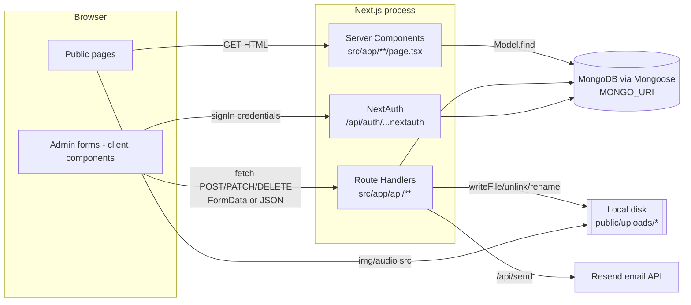
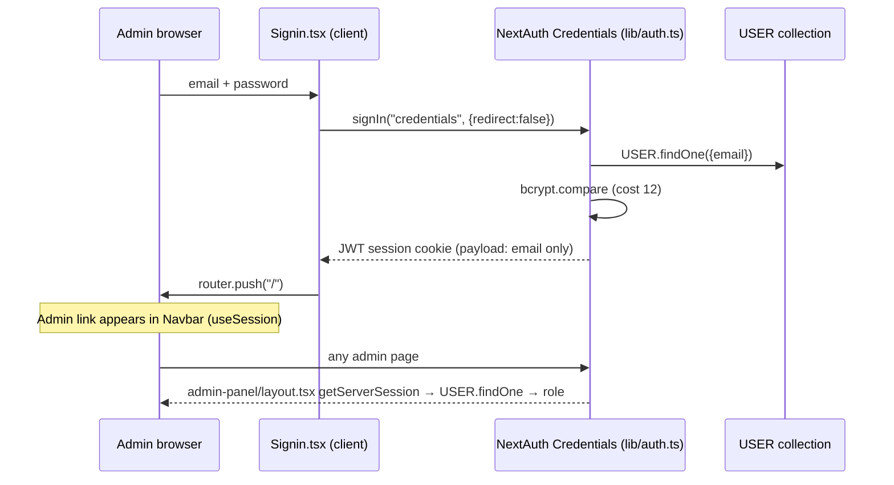

# ARCHITECTURE

## High-level

A single **Next.js App Router** monolith (originally Next 14.2.5, see STACK.md). One process does everything:

- **Server Components** query MongoDB **directly** through Mongoose to render pages.
- **Route Handlers** (`src/app/api/**/route.ts`) are used **only for mutations** (create/update/delete), the contact email and NextAuth.
- Uploaded media is written to the **local filesystem** under `public/uploads/…` and served as static files.



There is **no** separate service layer, repository layer, validation layer, middleware, caching layer or CDN/object storage.

## Frontend structure

```
src/
  app/                      routes (App Router)
    layout.tsx              <html lang="fa" dir="rtl">, font, providers, Layout
    page.tsx                home (placeholder)
    (auth)/signin/          sign-in
    zekr/ ziartnameh/ ceromony/ trustess/ oldSlaves/ contactus/ donate/
    admin-panel/            layout.tsx = auth gate + AdminLayout
    api/                    route handlers (see API.md)
  components/
    layout/                 Layout (public shell), AdminLayout (admin sidebar)
    template/               one "page body" component per route (≈34 files)
    module/                 reusable pieces: Navbar, Footer, Input, Loader, Slider, form sub-editors
    constants/              card components (misnamed "constants"; files often "*Cart" = card)
    elements/               Delete*Button client components (7 near-identical copies)
    lib/auth.ts             NextAuth options (misplaced under components)
  models/                   Mongoose models
  types/                    enums.ts (roles, Persian ERROR/MESSAGE strings), types.ts, next-auth.d.ts
  utils/                    connectDB, bcrypt helpers, font, digit converters, finglish slug, mask, sortTrustees
  providers/                NextAuthProvider (SessionProvider)
```

**Pattern (Fact):** `app/**/page.tsx` is a thin async Server Component. It calls `connectDB()`, queries a model, and renders a `template/*` component with the data. Mongoose documents are passed to children either raw or as `JSON.stringify(doc)` strings, which the child then `JSON.parse`s. Both styles are mixed (DECISIONS.md D-05).

**Rendering strategy:**
- Pages using `connectDB` + `getServerSession` or `searchParams` render dynamically.
- Pages that only query the DB without dynamic APIs (for example `/oldSlaves`, `/trustess`, `/ceromony`) may be **statically prerendered at build time** under Next 14 defaults. Updates then wouldn't appear until a rebuild or revalidation, because there's no `revalidate`/`dynamic` export anywhere. **Unknown**: production behavior wasn't observed, and the client `router.refresh()` only refreshes the router cache.
- No `loading.tsx`, `error.tsx` or `not-found.tsx` exist. "Not found" is rendered inline with HTTP 200.

**Client state:** local `useState` only. There's no global store, form library, or data-fetching library. Mutations use `fetch` followed by `router.push`/`router.refresh()`. Feedback uses `react-hot-toast`, and each component mounts its **own** `<Toaster />`.

**Forms:** controlled inputs through the shared `M/Input.tsx`, which renders a text input, a textarea, or a hidden file input with a styled label. All forms submit through a button `onClick` rather than `<form onSubmit>`. Jalali dates use `react-multi-date-picker` and are stored as ISO strings.

**Styling:** Tailwind CSS v3 config (`tailwind.config.ts`) with custom tokens, plus `src/app/globals.css` (date-picker overrides and a keyframe). Dark mode uses the `class` strategy through next-themes. Details are in UI-UX.md.

## Backend structure

Every route handler repeats the same inline sequence:
1. `connectDB()`
2. parse `formData()`/`json()`
3. `getServerSession(authOptions)`, returning 401 if there's no session
4. (sometimes) `USER.findOne({email})`, returning 404
5. ad-hoc presence checks, returning 422
6. file I/O
7. a Mongoose write
8. `NextResponse.json({message}|{error}, status)`

The whole body is wrapped in `try/catch`, which logs and returns 500 `{error: ERROR.SERVER_ERROR}`.

All user-facing strings are Persian enums in `src/types/enums.ts` (`ERROR`, `MESSAGE`). The upload logic (mkdir, unique name `YYYY-MM-DD$<orig>$<ts>-<rand>.<ext>`, writeFile) is **copy-pasted ~10 times** with no shared helper.

## Database architecture

MongoDB through Mongoose, with one connection reused through `mongoose.connections[0].readyState` (`src/utils/connectDB.ts`). There are four document collections plus one **singleton document** (`Save`) that holds three embedded lists (years, trustees, pir-gholaman), addressed by the env var `SAVE_DATA_BASE_ID`. Details are in DATABASE.md.

## Data flow examples

**Public read (zekr list):** `GET /zekr?year=1403` → `src/app/zekr/page.tsx` → `Zekr.find()` (all docs) + `Save.findOne(SAVE_DATA_BASE_ID)` → in-memory filter by `Year` → `Zekrpage` → `ZekrCart`.

**Admin write (add ziyarat):** `AddziartnamehPage` builds `FormData` (Title, Description, `Text`=JSON string, `Voice`=File) → `POST /api/Ziartnameh` → session check → `JSON.parse(Text)` → validates each section → writes the audio to `public/uploads/voices/` → `Ziartnameh.create` → 201 → client `router.push('/admin-panel/ziartnameh')`.

## Authentication flow



- Session strategy: **JWT**. The token holds only `email`, and the **role is re-read from the DB** on each admin render. No custom `callbacks`, `pages` or `secret` option is set; NextAuth reads `NEXTAUTH_SECRET`/`NEXTAUTH_URL` from env.
- `src/components/lib/auth.ts` **also** exports a `GET`/`POST` NextAuth handler (dead duplicate of `src/app/api/auth/[...nextauth]/route.ts`).
- **Bootstrap:** the first OWNER can't be created through the UI. `signup` always creates `role: ADMIN` (the schema default). The OWNER must have been set manually in the DB (**Inference**).

## Authorization (Fact: weakest part of the system)

| Layer | What is checked |
|---|---|
| `admin-panel/layout.tsx` | Session exists, and the user exists in the DB |
| Individual admin pages | Some check `role === ADMIN` and redirect or deny (admins list, trustees add/edit, pir-gholaman add) |
| Route handlers | **Only `session` exists.** No handler checks the role. `trustees`, `oldSlaves` and `year` don't even check that the user still exists |
| `POST /api/auth/signup` | **No check at all.** Anyone on the internet can create an admin account and then use every mutation API |

## Configuration

Environment variables referenced (names only, never values):

| Variable | Used in | Purpose |
|---|---|---|
| `MONGO_URI` | `src/utils/connectDB.ts` | MongoDB connection string |
| `MONGO_USER`, `MONGO_PASS` | not referenced in code | Probably embedded in `MONGO_URI`; unused |
| `SAVE_DATA_BASE_ID` | every handler/page using `Save` | `_id` of the singleton `Save` document |
| `NEXTAUTH_URL`, `NEXTAUTH_SECRET` | NextAuth (implicit) | Auth base URL and JWT signing secret |
| `RESEND_API_KEY` | `src/app/api/send/route.tsx` | Resend email API |

⚠ `.env` is **committed to git** (tracked since `f23c9fa`; `.gitignore` only ignores `.env*.local`). Treat every secret in it as compromised (PROGRESS.md, ROADMAP.md C-01).

## Deployment

**Unknown.** There's no Dockerfile, CI, `vercel.json` or hosting configuration. `next.config.mjs` is empty. Constraints the architecture imposes:
- It needs a **persistent, writable filesystem** next to the app, because uploads go to `public/`. Serverless hosts (for example Vercel) would lose uploads.
- With `next start`, files added to `public/` after build may not be served. **Unknown**: depends on version and host.

## Important architectural weaknesses

1. Broken authorization: public signup, no role checks in APIs (above).
2. Committed secrets.
3. Media on local disk with paths **derived from the record's title** (DECISIONS.md D-07). Renames, transliteration collisions (`persianToFinglish` maps several letters to the same Latin letter) and mismatched slug logic cause lost or orphaned files.
4. The singleton `Save` document mixes unrelated lists. That means read-modify-write of whole arrays, unawaited `save()` calls (race conditions), and no per-item validation.
5. No input validation, no MIME/size limits on uploads, files named partly from user-supplied names.
6. Heavy duplication: 7 delete buttons, ~10 upload blocks, 6 near-identical "not found" blocks, 2 duplicated contact data objects.
7. Pervasive `any` (≈145 occurrences) and ~40 `console.log` calls (one logs the plaintext password on signup: `src/app/api/auth/signup/route.ts`).
8. No tests, no error boundaries, no caching strategy.
