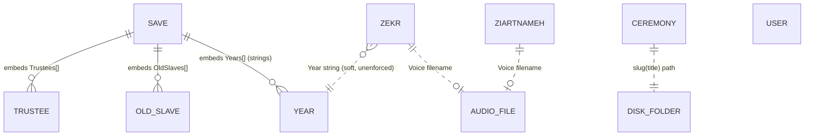

# DATABASE

**Technology:** MongoDB, accessed only through Mongoose (`src/models/*.ts`). Connection: `src/utils/connectDB.ts` (`mongoose.connect(process.env.MONGO_URI)`, `strictQuery: false`, reused while `readyState` is truthy).
**Not verified:** the live database wasn't queried. Collection names below follow the schema options. Real data volume and shape are **Unknown**.

No model defines **indexes**, **unique constraints**, **timestamps** (`createdAt`/`updatedAt`) or custom validators, and no references (`ref`) exist between collections. The only validation is `required`, and most `required` string fields also have `default: ""`, which defeats the check.

## Collections

### `USER` — model `USER` (`src/models/user.ts`)
| Field | Type | Notes |
|---|---|---|
| `email` | String, required | **Not unique.** Uniqueness only checked in the signup handler (race-prone) |
| `password` | String, required | bcrypt hash, cost 12 (`src/utils/auth.ts`) |
| `role` | String, required, default `ADMIN` | `ROLE` enum: `OWNER` \| `ADMIN` (`src/types/enums.ts`). Not enforced as an enum in the schema |

Owner: authentication. The OWNER account must be created out of band (ARCHITECTURE.md → Authentication).

### `Zekr` — model `Zekr` (`src/models/zekr.ts`)
| Field | Type | Notes |
|---|---|---|
| `Title` | String, required | |
| `Author` | String, required | Poet |
| `Year` | String, required | Must be in `Save.Years` at create/edit time (checked in the API, not the schema). **Soft reference:** deleting a year leaves zekrs pointing to it |
| `Voice` | String | Filename under `public/uploads/voices/` or `null` |
| `Zekr_Text.FirstParagraph` / `.SecondParagraph` | sub-doc, required | Each `{ Description: String, Zekr_text_p: [String], hadith: String }` |

The stanza count is fixed at two by the schema.

### Ziyarat-nameh — model `Ziartnameh` (`src/models/ziaratnameh.ts`)
| Field | Type | Notes |
|---|---|---|
| `Title`, `Description` | String, required | |
| `Voice` | String | Filename under `public/uploads/voices/` or `null` |
| `Text` | Array of `{ Original: String req, Translation: String req, Supplement: String }` | Ordered sections |

⚠ The schema option is `{ collection: "" }`. An empty string is falsy, so Mongoose most likely falls back to the default pluralized name (`ziartnamehs`). **Unverified**: confirm in the live DB.

### `ceremonies` (default name) — model `Ceremony` (`src/models/cermony.ts`)
| Field | Type | Notes |
|---|---|---|
| `title`, `description` | String, required | **lower-case field names** (other models use PascalCase) |
| `date` | String, required | ISO 8601 string from the date picker, displayed as Jalali |
| `coverImage` | String, required | Filename in `public/uploads/images/cermony/<slug(title)>/cover/` |
| `images` | [String], required | Filenames in `public/uploads/images/cermony/<slug(title)>/` |

`<slug(title)>` = `persianToFinglish(title).replace(/[^a-z0-9]/gi,'_').toLowerCase()` (`src/utils/prTOen.ts`). The **folder is derived from the title at read time**, so DB rows and disk folders are coupled through mutable text (DECISIONS.md D-07).

### `Save` — model `Save` (`src/models/save.ts`) — **singleton document**
One document, addressed everywhere by `process.env.SAVE_DATA_BASE_ID`. If it's missing, nearly every page and handler throws (`save.Years` of `null`).

| Field | Type | Notes |
|---|---|---|
| `Years` | [String], default `["Uncategorized"]` | Free-text years (for example Jalali years). Sorted with `parseInt` for display |
| `Trustees` | [TrusteesPerson] | Embedded sub-docs with auto `_id` |
| `OldSlaves` | [OldSlaves] | Embedded sub-docs with auto `_id` (pir-gholaman memorial) |

Embedded `TrusteesPerson`: `fullName` String req, `phone` String req (⚠ **personal mobile numbers, published publicly**, see FEATURES.md F-06), `role` String req default `"عضو هیئت امنا"` (the `TRUSTEES_ROLE` enum values are **Persian strings stored verbatim**: `رئیس هیئت امنا`, `عضو هیئت امنا`, `عضو علی‌البدل`), `img` String (filename in `public/uploads/images/Trustees/`).

Embedded `OldSlaves`: `fullName` String req, `date` String req (ISO date of death), `img` String (filename in `public/uploads/images/oldSlaves/`).

Write pattern: handlers load the whole document, rebuild the array in JS, assign it, and call `save.save()`, often **without `await`** (`trustees` POST/DELETE, `oldSlaves` POST, `year` POST/DELETE). Concurrent edits can overwrite each other, and errors after the response are lost.

### `blogposts` (default name) — model `BlogPost` (`src/models/blogs.ts`) — *abandoned feature*
`title`, `author` (String req), `thumbnailUrl` (String), `content` ([{ type: String req, children: [Mixed] req, src, alt }]). The only writer (`POST /api/blog`) stores a JSON **string** into `content`, which doesn't match the schema.

## Relationships

## Data ownership and dependencies

| Data | Written by | Read by |
|---|---|---|
| USER | `/api/auth/signup`, `/api/auth/delete/[id]` | NextAuth `authorize`, admin layout/pages, every API session check |
| Zekr | `/api/zekr`, `/api/zekr/delete/[id]` | `/zekr`, `/zekr/[id]`, admin zekr pages |
| Ziartnameh | `/api/Ziartnameh`, `/api/Ziartnameh/delete/[id]` | `/ziartnameh`, `/ziartnameh/[id]`, admin pages |
| Ceremony | `/api/ceremony`, `/api/ceremony/delete/[id]` | `/ceromony`, `/ceromony/[id]`, admin pages |
| Save.Years | `/api/year` | zekr pages and APIs |
| Save.Trustees | `/api/trustees`, `/api/trustees/delete/[id]` | `/trustess`, admin trustees |
| Save.OldSlaves | `/api/oldSlaves`, `/api/oldSlaves/delete/[id]` | `/oldSlaves`, admin pages |

## Sensitive data

- Password hashes (USER).
- Trustee phone numbers, a privacy issue, since they're currently public.
- Names and photos of living trustees and deceased elders. These are culturally sensitive, and a rebuild should get explicit consent and allow hiding them.

Never copy real records into documentation or fixtures.
